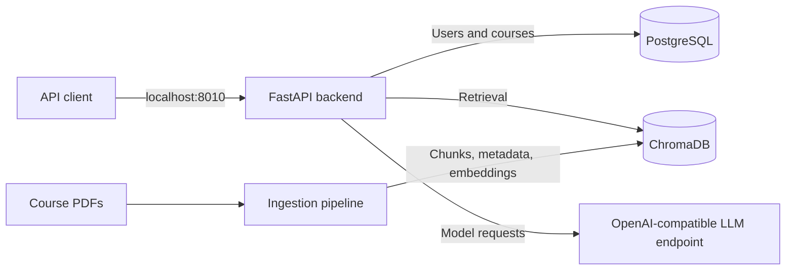

# Learning Assistant

A student-built, retrieval-augmented learning assistant designed to turn course material into a more interactive learning experience. The project combines document processing, semantic retrieval, and language models to support guided lectures and course-aware questions and answers.

**Project status:** The infrastructure and application are under active development. Lecture mode and Q&A mode have dedicated routes and services that are still being developed. The current container architecture provides a foundation for local development and will continue to evolve.

## What the project explores

- **Guided learning:** A lecture engine organizes lessons around concepts and student actions, such as continuing, simplifying an explanation, or requesting an example.
- **Course-aware Q&A:** A retrieval pipeline searches relevant lesson material and passes context and conversation history to a language model.
- **Document ingestion:** PDF processing extracts and cleans text, detects course concepts, creates chunks, and generates embeddings for retrieval.
- **Backend infrastructure:** A containerized API connects a relational database, a vector database, local embedding models, and a configurable language-model endpoint.

## Architecture



Docker Compose runs the backend and databases as separate services. The PDF ingestion pipeline is part of the application code. The language-model endpoint is configured externally.

| Component | Technology | Role |
| --- | --- | --- |
| Backend | Python 3.12, FastAPI, Uvicorn | API routes and application services |
| Relational database | PostgreSQL 16 | Structured user and course data |
| Vector database | ChromaDB 1.5.9 | Course chunks, metadata, embeddings, and retrieval |
| Embeddings | Sentence Transformers, PyTorch, ModelScope | Generate embeddings using `BAAI/bge-small-en-v1.5` |
| Language models | OpenAI Python client | Connect to a configurable OpenAI-compatible endpoint |
| Document processing | pdfplumber | Extract text from course PDFs |
| Orchestration | Docker Compose | Run and connect the local services |

## Infrastructure and design choices

- **Purpose-built data stores:** PostgreSQL handles relational data, while Chroma stores course material for semantic retrieval. The Chroma collection uses cosine distance.
- **Containerized services:** The API, PostgreSQL, and Chroma run in separate containers and communicate over the Compose network. Database health checks control when the backend starts.
- **Persistent data:** Named Docker volumes preserve PostgreSQL and Chroma data across container recreation. A mounted model cache lets the backend reuse downloaded embedding files.
- **CPU-based embeddings:** The backend image installs CPU-only PyTorch for local embedding generation, avoiding a dependency on NVIDIA CUDA for the development setup.
- **Retrieval tailored to each mode:** Lecture retrieval uses course, lesson, and concept metadata. Q&A uses vector similarity with a lexical fallback to find relevant course material.
- **Configurable model integration:** Model names, credentials, and the API base URL are supplied through environment variables, keeping the language-model connection configurable.
- **Session-oriented design:** Lecture and Q&A services maintain their own session state and separate orchestration from retrieval and response generation.

## Local setup

### Prerequisites

- Docker and the Docker Compose plugin
- An internet connection for dependencies and the embedding model
- An API key and model names for an OpenAI-compatible language-model endpoint

### Configuration

Create a `.env` file in the project root with your own values:

```dotenv
POSTGRES_USER=your_database_user
POSTGRES_PASSWORD=your_database_password
POSTGRES_NAME=your_database_name

CHROMADB_USER=placeholder
CHROMADB_PASSWORD=placeholder
CHROMADB_NAME=placeholder

OPENROUTER_API_KEY=your_api_key
BASE_URL=your_openai_compatible_api_base_url
TEACHER_MODEL=your_teacher_model
MEMORY_MODEL=your_memory_model
ROUTER_MODEL=your_router_model
```

Compose supplies the database host and port values to the backend. The Chroma user, password, and name variables are currently required by the settings class; the Chroma client currently connects using its host and port. The placeholders above do not configure authentication. Keep `.env` out of version control.

Create the model cache directory and ensure it is writable by the container's `appuser`:

```bash
mkdir -p .modelscope-cache
```

### Start the services

```bash
docker compose up -d --build
```

The API is available at [http://localhost:8010](http://localhost:8010), with interactive documentation at [http://localhost:8010/docs](http://localhost:8010/docs). To inspect the services:

```bash
docker compose ps
docker compose logs -f backend
```

## Project structure

```text
INGESTION/          PDF processing, chunking, and indexing
RAG/LECTURE/        Lecture routes, engine, and teaching state
RAG/QA/             Q&A routes, retrieval, and session logic
SHARED/             Configuration, embeddings, clients, and prompts
USERS/              User and course routes and database services
dockerfile          Backend container definition
docker-compose.yml  Local service configuration
```

## Roadmap

The current infrastructure is a starting point for an evolving system. Planned work includes continuing development of the lecture and Q&A services, adding **object storage** for course documents, and introducing **Redis caching**. Object storage and Redis are future additions and are not part of the current Compose stack.
